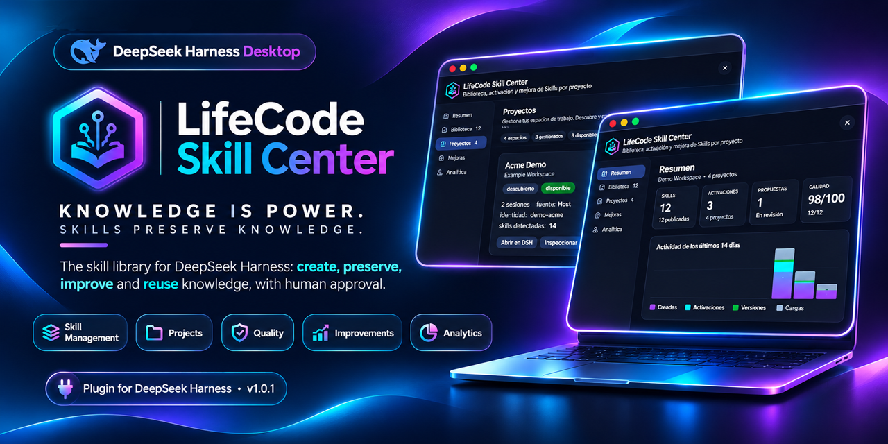
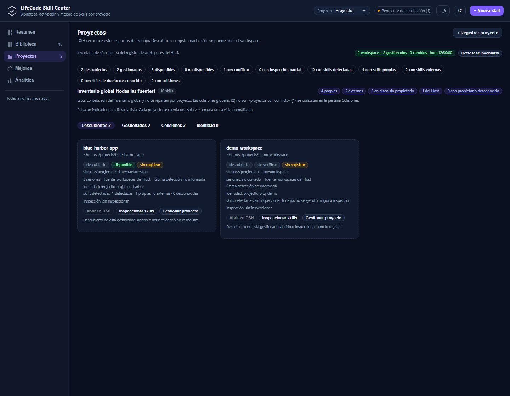

# LifeCode Plugins for DeepSeek Harness

<p align="center">
  <strong>LifeCode</strong> — Knowledge is Power. Skills Preserve Knowledge.
</p>

<table align="center">
  <tr>
    <td align="center" width="50%">
      
      <br><sub><strong>LifeCode Skill-Compiler</strong> — proposes Skills; a person approves</sub>
    </td>
    <td align="center" width="50%">
      
      <br><sub><strong>LifeCode Skill Center</strong> — administers, preserves and reuses them</sub>
    </td>
  </tr>
</table>

<h3 align="center">Knowledge is Power. Skills Preserve Knowledge.</h3>

<p align="center">
  A family of plugins that turn AI experience into reusable, governed knowledge.<br>
  <a href="#english">English</a> · <a href="#español">Español</a>
</p>

---

## English

### Turn AI Experience Into Reusable Knowledge

LifeCode is a family of plugins for **DeepSeek Harness**. It exists for one reason: the knowledge behind a
great AI workflow should not disappear when the conversation ends. A useful procedure, a hard-won check, a
decision with its context — all of it can become a **Skill**: a portable, reviewable instruction document
that a person can approve, assign, and switch on.

The family has two independent plugins with one shared rule: **nothing activates by itself.** The Compiler
proposes; the Skill Center administers; a person decides.

### Two plugins, one principle

| Plugin | What it does | Status |
|---|---|---|
| [**LifeCode Skill-Compiler**](skill-compiler/README.md) | Progressive learning: turns the reusable knowledge of a task into a **proposed Skill**, scoped to one project or to all — you choose when approving — and vendors third-party Skills as our own version with provenance. | Stable · v5.0.2 |
| [**LifeCode Skill Center**](lifecode-skill-center/README.md) | The visual control center: persistent library, deterministic quality gate, immutable versions with rollback, per-project switch, global inventory with provenance, collision detection, project administration, activity and notifications. The AI creates and proposes; the person approves and enables. | Stable · **v1.0.1 candidate** |

The two plugins are separate installations. The Skill Center does not replace the Compiler, and the
Compiler does not activate anything on its own.

### What is in this repository

```text
plugins-dsh/
├── skill-compiler/        # the knowledge compiler plugin
├── lifecode-skill-center/ # the visual skill center plugin
├── assets/                # shared brand artwork
├── docs/                  # repository governance and design notes
└── plans/                 # authorized work plans
```

Each plugin keeps its code, tests, and documentation in its own directory and is installed as a **bundle**
through the Host's plugin manager.

<p align="center">
  
</p>

### Why LifeCode

- **Preservation, not just retrieval.** The knowledge behind the workflow — checks, decisions, conditions —
  becomes a durable Skill.
- **Human approval at every boundary.** The AI proposes; publishing, assigning, and enabling are human acts.
- **Evidence, not guesses.** Provenance and confidence are part of the result; risky writes are fail-closed.
- **Local-first.** User-owned storage under `DSH_HOME`; no telemetry and no external service.

Continue with the product landing page:
[**LifeCode Skill Center →**](lifecode-skill-center/README.md)

### Installation at a glance

> **The release is ready as a candidate, but the GitHub installation is not verified yet** (publication is
> still pending). The verified route is a local install from an absolute path.

```sh
git clone https://github.com/designerbyron/plugins-dsh.git
cd <donde-clonaste-el-repo>/lifecode-skill-center
npm install
```

Then open **Plugins → Add plugin**, paste the absolute path of `lifecode-skill-center`, install, choose
**Enable now**, restart the Harness if requested, and reload the page. Full instructions and the candidate
GitHub syntax: [INSTALLATION.md](lifecode-skill-center/docs/INSTALLATION.md).

### Documentation

- [Skill Center — product README](lifecode-skill-center/README.md)
- [Skill Center — installation](lifecode-skill-center/docs/INSTALLATION.md) ·
  [architecture](lifecode-skill-center/docs/ARCHITECTURE.md) ·
  [security](lifecode-skill-center/docs/SECURITY.md) ·
  [troubleshooting](lifecode-skill-center/docs/TROUBLESHOOTING.md)
- [Skill Center — changelog](lifecode-skill-center/CHANGELOG.md)
- [Skill-Compiler — README](skill-compiler/README.md)
- [Repository governance](docs/README.md)
- Final gates and reproducible numbers: [`_audit/FINAL-RELEASE-READINESS.md` §E](_audit/FINAL-RELEASE-READINESS.md)

### Repository notes

The repository lives under `htdocs` by operator decision. It carries a `.htaccess` with `Require all denied`
so that neither the code nor `.git/` can be served by Apache. That file is a safety net, not a publication
strategy: if anything from this directory is ever served, review that decision first.

### License and support

The LifeCode Skill Center plugin is MIT-licensed — see
[lifecode-skill-center/LICENSE](lifecode-skill-center/LICENSE), Copyright © 2026 Byron Vanegas.
This repository as a whole is also MIT — see [LICENSE](LICENSE). Copyright holder: `designerbyron`.

LifeCode Skill Center was originally created and developed by Byron Vanegas as part of the LifeCode
ecosystem. Official repository: [designerbyron/plugins-dsh](https://github.com/designerbyron/plugins-dsh) ·
Support: [GitHub Issues](https://github.com/designerbyron/plugins-dsh/issues).

The MIT license requires keeping the copyright notice. Referencing the original repository is a request, not
a condition. LifeCode is the product family; a brand name does not replace the license holder. Product name,
logo, and fork guidance: [lifecode-skill-center/docs/LEGAL.md](lifecode-skill-center/docs/LEGAL.md).

---

## Español

### Convierte la experiencia de la IA en conocimiento reutilizable

LifeCode es una familia de plugins para **DeepSeek Harness**. Existe por una razón: el conocimiento que hay
detrás de un buen flujo de trabajo con IA no debería desaparecer cuando termina la conversación. Un
procedimiento útil, una comprobación costosa, una decisión con su contexto — todo eso puede convertirse en
una **Skill**: un documento de instrucciones portable y revisable que una persona puede aprobar, asignar y
encender.

La familia tiene dos plugins independientes con una regla común: **nada se activa solo.** El Compiler
propone; el Skill Center administra; la persona decide.

### Dos plugins, un principio

| Plugin | Qué hace | Estado |
|---|---|---|
| [**LifeCode Skill-Compiler**](skill-compiler/README.md) | Aprendizaje progresivo: convierte el conocimiento reutilizable de una tarea en una **skill propuesta**, con ámbito de un proyecto o de todos —lo eliges al aprobar—; y vendoriza skills de repositorios ajenos como nuestra versión, con procedencia. | Estable · v5.0.2 |
| [**LifeCode Skill Center**](lifecode-skill-center/README.md) | El centro visual: biblioteca persistente, compuerta de calidad determinista, versiones inmutables con vuelta atrás, interruptor por proyecto, inventario global con procedencia, detección de colisiones, administración de proyectos, actividad y notificaciones. La IA crea y propone; la persona aprueba y enciende. | Estable · **candidato v1.0.1** |

Los dos plugins se instalan por separado. El Skill Center no sustituye al Compiler, y el Compiler no activa
nada por su cuenta.

### Qué contiene este repositorio

```text
plugins-dsh/
├── skill-compiler/        # el plugin compilador de conocimiento
├── lifecode-skill-center/ # el plugin centro visual de skills
├── assets/                # arte de marca compartido
├── docs/                  # gobernanza y notas de diseño del repositorio
└── plans/                 # planes de trabajo autorizados
```

Cada plugin vive en su carpeta, con su código, sus pruebas y su documentación, y se instala como **bundle**
con el gestor de plugins del Host.

<p align="center">
  
</p>

### Por qué LifeCode

- **Preservar, no sólo recuperar.** El conocimiento que hay detrás del flujo —comprobaciones, decisiones,
  condiciones— se convierte en una Skill durable.
- **Aprobación humana en cada frontera.** La IA propone; publicar, asignar y encender son actos humanos.
- **Evidencia, no suposiciones.** La procedencia y la confianza forman parte del resultado; las escrituras
  arriesgadas son fail-closed.
- **Local-first.** Almacenamiento del usuario bajo `DSH_HOME`; sin telemetría ni servicio externo.

Continúa en la página de producto:
[**LifeCode Skill Center →**](lifecode-skill-center/README.md)

### Instalación en resumen

> **El release está listo como candidato, pero la instalación desde GitHub no está verificada todavía** (la
> publicación sigue pendiente). La ruta verificada es la instalación local desde una ruta absoluta.

```sh
git clone https://github.com/designerbyron/plugins-dsh.git
cd <donde-clonaste-el-repo>/lifecode-skill-center
npm install
```

Después, abrir **Plugins → Add plugin**, pegar la ruta absoluta de `lifecode-skill-center`, instalar, elegir
**Enable now**, reiniciar el Harness si lo pide y recargar la página. Instrucciones completas y sintaxis
candidata: [INSTALLATION.md](lifecode-skill-center/docs/INSTALLATION.md).

### Documentación

- [Skill Center — README del producto](lifecode-skill-center/README.md)
- [Skill Center — instalación](lifecode-skill-center/docs/INSTALLATION.md) ·
  [arquitectura](lifecode-skill-center/docs/ARCHITECTURE.md) ·
  [seguridad](lifecode-skill-center/docs/SECURITY.md) ·
  [diagnóstico](lifecode-skill-center/docs/TROUBLESHOOTING.md)
- [Skill Center — cambios](lifecode-skill-center/CHANGELOG.md)
- [Skill-Compiler — README](skill-compiler/README.md)
- [Gobernanza del repositorio](docs/README.md)
- Gates finales y cifras reproducibles: [`_audit/FINAL-RELEASE-READINESS.md` §E](_audit/FINAL-RELEASE-READINESS.md)

### Nota sobre el repositorio

El repositorio vive bajo `htdocs` por decisión del operador. Lleva un `.htaccess` con `Require all denied`
para que ni el código ni `.git/` puedan servirse por Apache. Es una red de seguridad, no una estrategia de
publicación: si algún día se sirve algo desde aquí, esa decisión se revisa primero.

### Licencia y soporte

El plugin LifeCode Skill Center tiene licencia MIT — ver
[lifecode-skill-center/LICENSE](lifecode-skill-center/LICENSE), Copyright © 2026 Byron Vanegas.
Este repositorio en conjunto también es MIT — ver [LICENSE](LICENSE). Titular del copyright: `designerbyron`.

LifeCode Skill Center fue creado y desarrollado originalmente por Byron Vanegas como parte del ecosistema
LifeCode. Repositorio oficial: [designerbyron/plugins-dsh](https://github.com/designerbyron/plugins-dsh) ·
Soporte: [GitHub Issues](https://github.com/designerbyron/plugins-dsh/issues).

MIT obliga a conservar el aviso de copyright; referenciar el repositorio original es una petición, no una
condición. LifeCode es la familia de producto; una marca no sustituye al titular de la licencia. Nombre del
producto, logo y guía para forks: [lifecode-skill-center/docs/LEGAL.md](lifecode-skill-center/docs/LEGAL.md).
