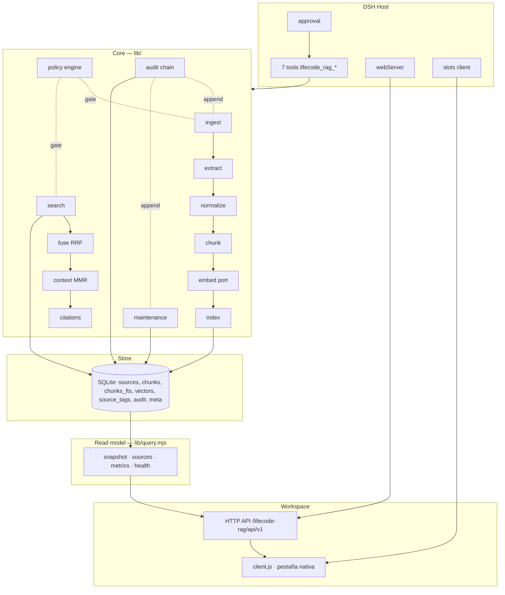
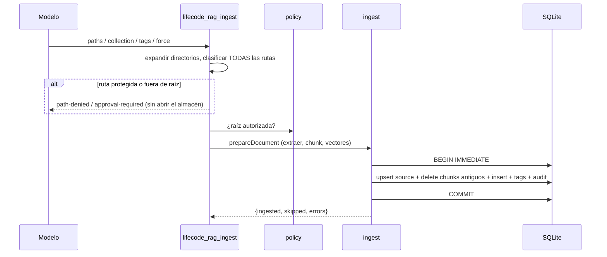
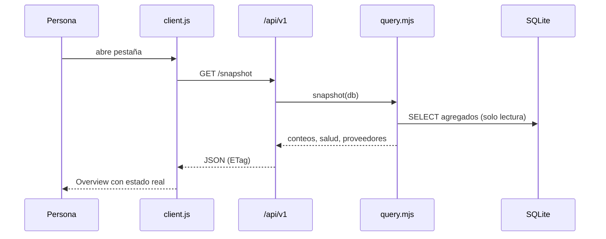

# LifeCode RAG — Arquitectura v0.2

**Fecha:** 2026-11-17 · **Ámbito:** `lifecode-rag/` · **Estado:** propuesta para autorización (no implementada)
**Base:** v0.1.0 implementada y verificada (66/66 pruebas, `check` verde, herméticos verdes)

---

## 1. Qué cambia y qué no

v0.1.0 es un **motor de herramientas**: siete tools `lifecode_rag_*` sobre un almacén SQLite propio.
v0.2.0 añade dos capas —**Workspace** (pestaña nativa) y **Observabilidad**— y convierte la recuperación
en una capacidad configurable, sin reescribir el motor.

Lo que **no** cambia:

- El contrato de las siete herramientas v0.1.0 queda congelado (ver `CONTRATO-v0.1.md`).
- El almacén sigue siendo SQLite propiedad exclusiva del plugin (`node:sqlite`, FTS5, vectores BLOB).
- Cero dependencias `@deepseek-ai/*` y cero dependencias de ejecución nuevas en esta etapa.
- La separación de etapas: ingesta → normalización → chunking → embeddings → índice → recuperación →
  contexto → citas. Ninguna etapa se salta ni se fusiona para "simplificar".

Lo que **sí** cambia:

- El Workspace **no lee tablas**: consume un *read model* (`lib/query.mjs`) y una API HTTP versionada.
- Se añaden métricas **agregadas** y un motor de **políticas** con tres niveles de automatización.
- Los embeddings dejan de ser un detalle interno y pasan a ser un **puerto** con proveedores evaluables.

## 2. Principios rectores

| Principio | Consecuencia arquitectónica |
|---|---|
| Independencia de Skill Center | Sin imports, sin rutas, sin estado ni ciclos de instalación compartidos. La única coincidencia permitida es que ambos son bundles de DSH. |
| Local First | Ninguna ruta de código abre sockets salvo un proveedor de embeddings declarado como remoto y aprobado por llamada. |
| Eficiencia de tokens | Recuperación selectiva, salida compacta por defecto, presupuesto de contexto explícito y medición del ahorro. |
| Fail-closed | Permiso ausente, estado ambiguo o validación fallida ⇒ error tipado, nunca una escritura parcial. |
| Una sola fuente de verdad | SQLite es autoritativo; las proyecciones (snapshot, métricas, JSONL de auditoría) son derivadas y regenerables. |
| Contratos antes que pantallas | La UI consume contratos versionados; nunca conoce el esquema interno. |

## 3. Vista de capas



Regla de dependencia, verificable con `tools/check.mjs`:

```
index.js → lib/tools.mjs → lib/{ingest,search,context,maintenance}
lib/query.mjs → lib/db.mjs (solo lectura)
lib/workspace-api.mjs → lib/query.mjs (+ acciones que llaman al core)
client.js → HTTP únicamente
lib/core nunca importa lib/workspace-api, lib/query, client ni nada del Workspace
```

## 4. Módulos de v0.1.0 (baseline real)

| Módulo | Responsabilidad | Estado |
|---|---|---|
| `lib/paths.mjs` | Raíz, configuración, `isWithin`. | implementado |
| `lib/errors.mjs` | `RagError`, 25 códigos declarados. | implementado, con deuda (3 códigos emitidos sin declarar) |
| `lib/hash.mjs` | SHA-256, digest normalizado, `chunk_key`. | implementado |
| `lib/schema.mjs` | DDL v2, `application_id`, `meta`. | implementado |
| `lib/db.mjs` | Apertura, guardas, transacciones, FTS integrity/rebuild. | implementado |
| `lib/extract.mjs` | Formatos texto, HTML/JSON/JSONL/CSV, normalización. | implementado |
| `lib/chunk.mjs` | Chunking con solape, encabezados, offsets. | implementado |
| `lib/embed.mjs` | `local-hash-v1` (256 dims), coseno, BLOB. | implementado, **léxico** |
| `lib/ingest.mjs` | Preparación completa y sustitución atómica por fichero. | implementado |
| `lib/search.mjs` | FTS5/BM25, vectores, RRF k=60, filtros. | implementado |
| `lib/context.mjs` | MMR, presupuesto, citas. | implementado |
| `lib/maintenance.mjs` | forget, reindex fts/vectors/all. | implementado |
| `lib/audit.mjs`, `lib/audit-export.mjs` | Cadena de hashes, export JSONL, verificación. | implementado |
| `lib/policy.mjs` | Rutas protegidas, symlink/junction, hardlink. | implementado |
| `lib/tags.mjs` | Etiquetas normalizadas. | implementado |
| `lib/doctor.mjs` | Diagnóstico. | implementado |
| `lib/tools.mjs`, `index.js` | Siete tools + adaptador. | implementado |

## 5. Módulos nuevos de v0.2.0

| Módulo | Responsabilidad | No puede |
|---|---|---|
| `lib/ports/embedding.mjs` | Contrato `EmbeddingProvider` + registro. | abrir red por sí mismo |
| `lib/ports/extractor.mjs` | Contrato `DocumentExtractor` (futuro PDF/DOCX). | importar el core |
| `lib/query.mjs` | Read model: snapshot, fuentes, salud, métricas. Solo `SELECT`. | escribir, abrir transacciones de escritura |
| `lib/metrics.mjs` | Agregación diaria, retención, consultas de series. | guardar prompts, respuestas o texto de consulta |
| `lib/policies.mjs` | Evaluación de políticas y clasificación de acciones. | conceder aprobaciones |
| `lib/workspace-api.mjs` | Rutas HTTP v1, validación de entrada, serialización. | acceder a tablas fuera de `query.mjs` |
| `lib/automation.mjs` | Indexación programada dentro de raíces autorizadas, con presupuesto. | saltarse `policy`/`approval` |

## 6. Puertos y contratos

### 6.1 `EmbeddingProvider`

```js
/**
 * @typedef {Object} EmbeddingProvider
 * @property {string} id            Identidad estable, p. ej. 'local-hash-v1' o 'onnx-minilm-multilingual-v1'
 * @property {number} dim
 * @property {'local'|'remote'} kind
 * @property {(texts: string[], opts?: {signal?: AbortSignal}) => Promise<Float32Array[]>} embedBatch
 */
```

Reglas: determinista para el mismo `id`+`dim`; L2-normalizado; error tipado (`embedding-failed`);
un proveedor remoto exige aprobación por llamada y no se activa por configuración sola. El `id` se
almacena junto a cada vector, de modo que dos modelos pueden convivir durante una migración.

### 6.2 `DocumentExtractor`

`{ id, extensions: string[], extract(bytes, {path, mime}) => {text, mime} }`. Los extractores registrados
se evalúan por extensión; ninguno puede leer fuera del buffer recibido.

### 6.3 `ReadModel`

`lib/query.mjs` expone funciones puras sobre una conexión de solo lectura:

```js
snapshot(db)            // { counts, health, lastIndexedAt, embedders: [...] }
listSources(db, query)  // paginado, filtros por colección/etiqueta/estado
sourceDetail(db, ref)   // metadatos + chunks (paginados, sin texto completo por defecto)
metricsSummary(db, {from, to})
metricsSeries(db, {metric, from, to, bucket})
```

Ninguna función de `query.mjs` puede recibir SQL, ni devolver filas crudas con columnas internas
(`prev_hash`, `vec` binario, `meta` completo).

## 7. Flujos

### 7.1 Ingesta (sin cambios de fondo)



Invariante I6: toda fila de `sources` tiene ≥1 chunk. Un fallo de preparación no toca la versión anterior.

### 7.2 Recuperación y contexto

1. `queryTokens` → FTS5 (`bm25`) y vector search (coseno) en paralelo lógico.
2. `fuseRrf` con k=60; empates por `chunk_key`.
3. `assembleContext` con MMR (λ=0.7), presupuesto en tokens estimados (`ceil(chars/4)`), sin cortar chunks.
4. Citas `[n]` con `chunkKey`, URI, offsets.

### 7.3 Workspace



El Workspace no escribe: las acciones (reindexar, olvidar, cambiar política) van por `POST /actions`,
pasan por el mismo evaluador de políticas y, cuando toca, por `ctx.approval.request`.

## 8. Aislamiento respecto de Skill Center

LifeCode Skill Center y LifeCode RAG comparten host, no producto. Concretamente:

- No hay imports cruzados ni rutas de estado compartidas.
- `PROTECTED_SEGMENTS = ['lifecode-skill-center']` sigue rechazando cualquier ruta que contenga ese
  segmento, incluidas las copias instaladas en el perfil.
- El Workspace de RAG vive en su propio slot (`sidebar.panellist` id `lifecode-rag`, `main` clave
  `lifecode-rag`); no reutiliza el id `lifecode-skill-center`.
- Los ciclos de instalación son independientes: dos bundles, dos filas de loader, dos versiones.

## 9. Compatibilidad con el host (evidencia)

| Capacidad | Contrato verificado | Fuente |
|---|---|---|
| Pestaña nativa | slot `sidebar.panellist` (lista, `id` direcciona el panel) + slot `main` (keyed, misma clave) | `Slots.listSubTree` en vivo; ocupantes actuales incluyen `lifecode-skill-center` |
| Panel activo | prop estándar `usePanelInfo` → `PanelInfo.activePanelId` (`null` = Conversación) | `dsh-client-ui-layout/src/client/service.ts` y `src/client/index.ts` |
| Icono de rail | props `{size, active}` del owner | catálogo del slot |
| HTTP | `ctx.webServer.register({kind, path, handler})`, rutas nombradas, `getOrigin()` | servicio `webServer` |
| Aprobaciones | `ctx.approval.request` → solo `allowed-once` concede | servicio `approval` |
| Working directory | `ctx.workingDirectory.ensure(agent, signal)` | servicio `workingDirectory` |
| Tema | tokens `--dsw-alias-*` (14 verificados) | `Theme.listTokens` |
| Cliente | `window.__ModuleLoader__.load({id, factory})`, React del loader | `ui-plugin.md` + precedente LSC |
| SQLite/FTS5 | `node:sqlite` 3.53.4 en el proceso host | sonda propia (v0.1.0) |

No se asume ninguna API por nombre: lo que no está en esta tabla se marca como no verificado en
`PLAN-v0.2.0.md` y se comprueba en M0 antes de escribir código.

**Ciclo de vida del panel.** El host no emite un evento de «panel seleccionado»; la señal es el hook
`usePanelInfo` que el runtime inyecta en el slot `main` (contrato de `dsh-client-ui-layout`). La UI lo usa
para detener el refresco cuando el panel no está activo (`WORKSPACE-UX.md` §5); `document.visibilityState`
solo cubre minimizado. Si ese hook desapareciera en una versión futura, el panel debe degradar a «sin
refresco automático», no a polling ciego.

## 10. Riesgos arquitectónicos

| Riesgo | Impacto | Mitigación |
|---|---|---|
| El read model se convierte en segunda lógica | Divergencia UI/motor | `query.mjs` solo agrega; los cálculos de recuperación siguen en `search`/`context` |
| Métricas que se vuelven vigilancia | Privacidad | Solo agregados; sin texto de consulta ni prompts; retención y borrado |
| Pestaña que ralentiza el escritorio | Mala experiencia | Carga diferida por sección, sin polling oculto, presupuestos medidos |
| Proveedor de embeddings que cambia la calidad | Regresión silenciosa | `model_id` por vector + evaluación obligatoria antes de promover |
| Automatización que erosiona aprobaciones | Seguridad | Tres niveles explícitos; el motor de políticas no puede conceder |
| Crecimiento del almacén | Coste y latencia | Retención de métricas, compactación documentada, límites por ingesta |

## 11. Decisiones abiertas

- Formato exacto del fichero de políticas (`policies.json` vs tabla `policies`): se decide en M1 con
  criterio de atomicidad y auditoría.
- ¿El Workspace necesita WebSocket para progreso de ingesta larga, o basta polling bajo demanda?
  Se mide en M3; por defecto, sin WebSocket.
- ¿Las métricas viven en SQLite o en un JSONL agregado? SQLite por transaccionalidad; se confirma en M1.
