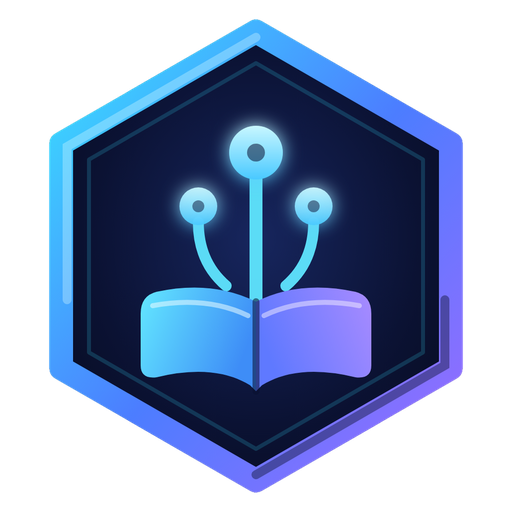
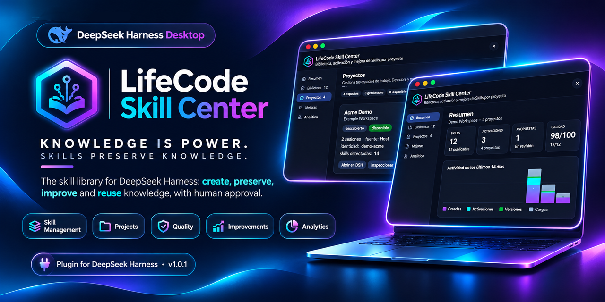
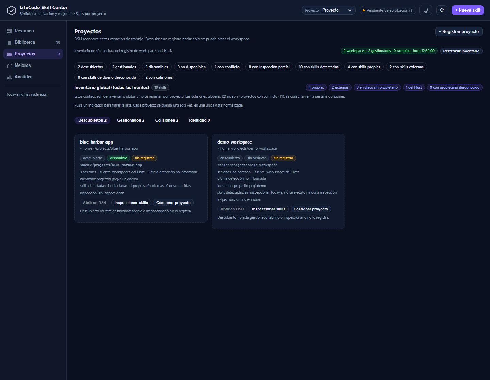
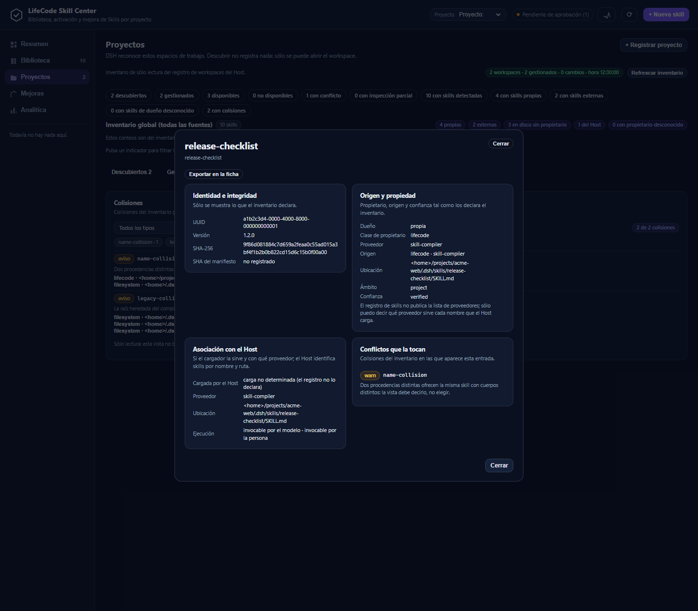
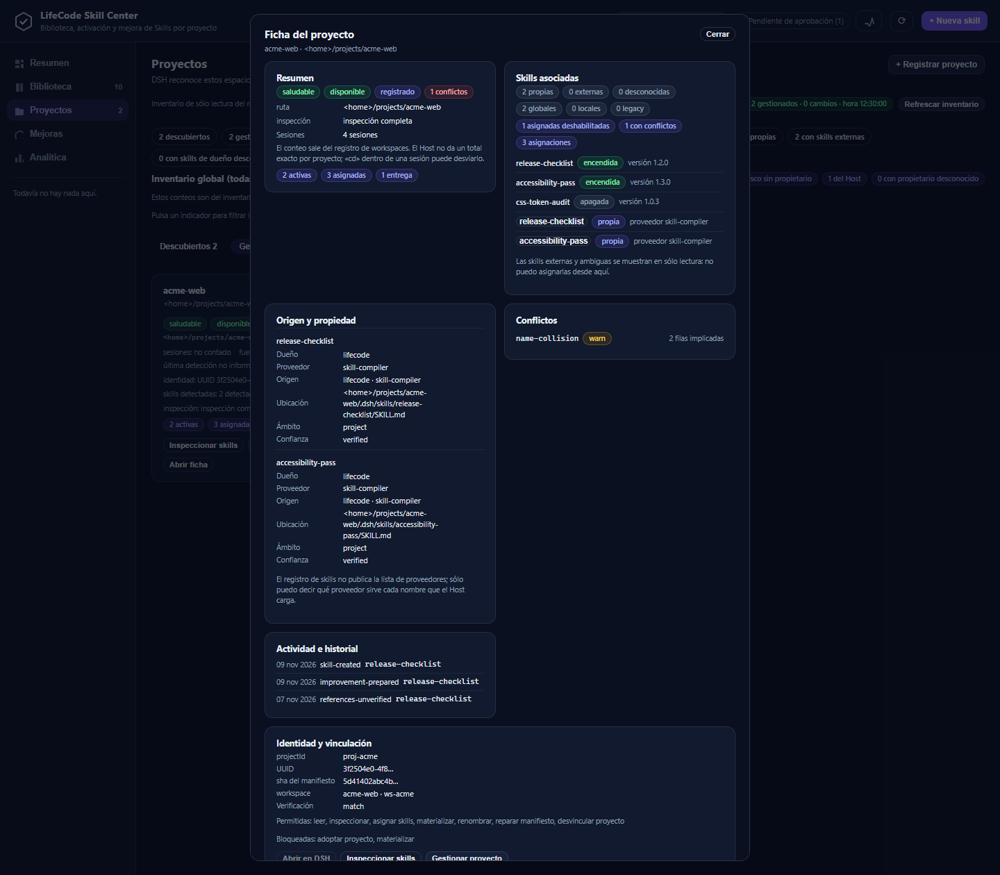
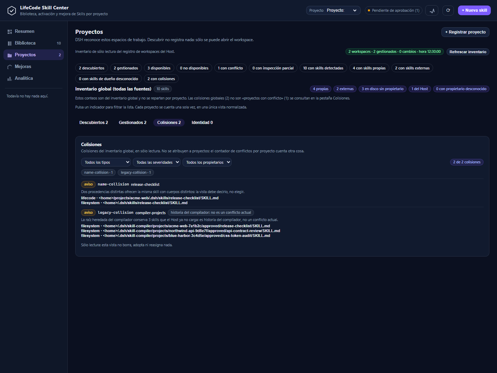
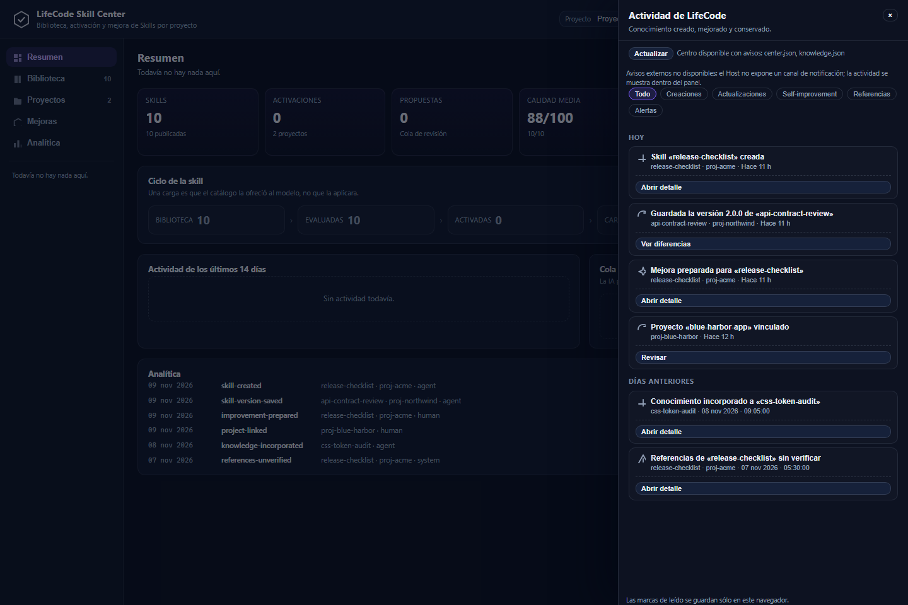
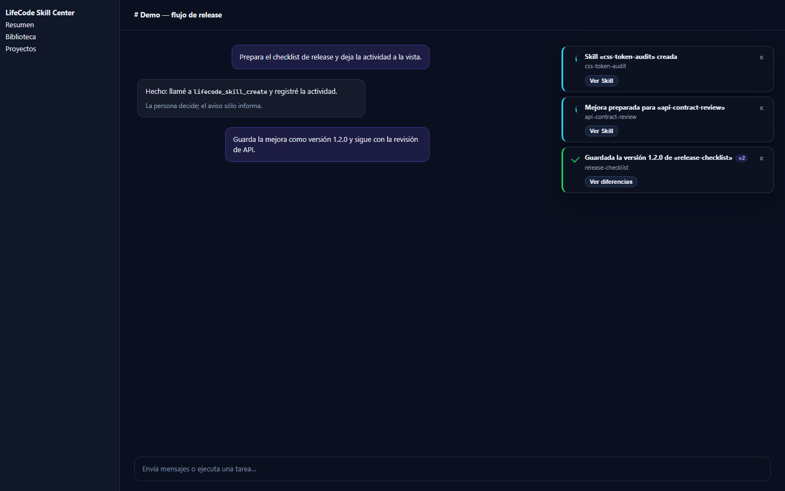
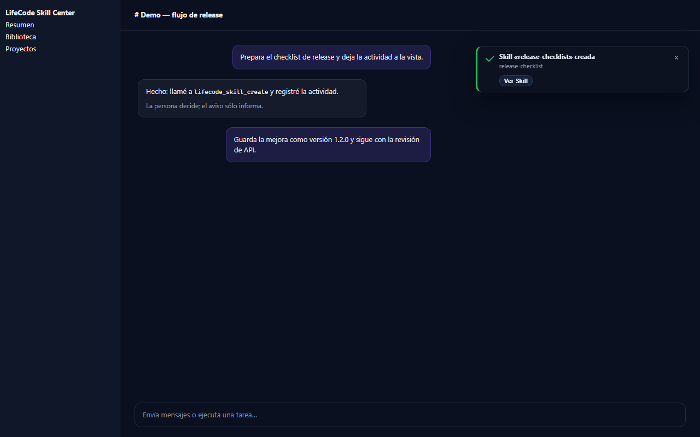
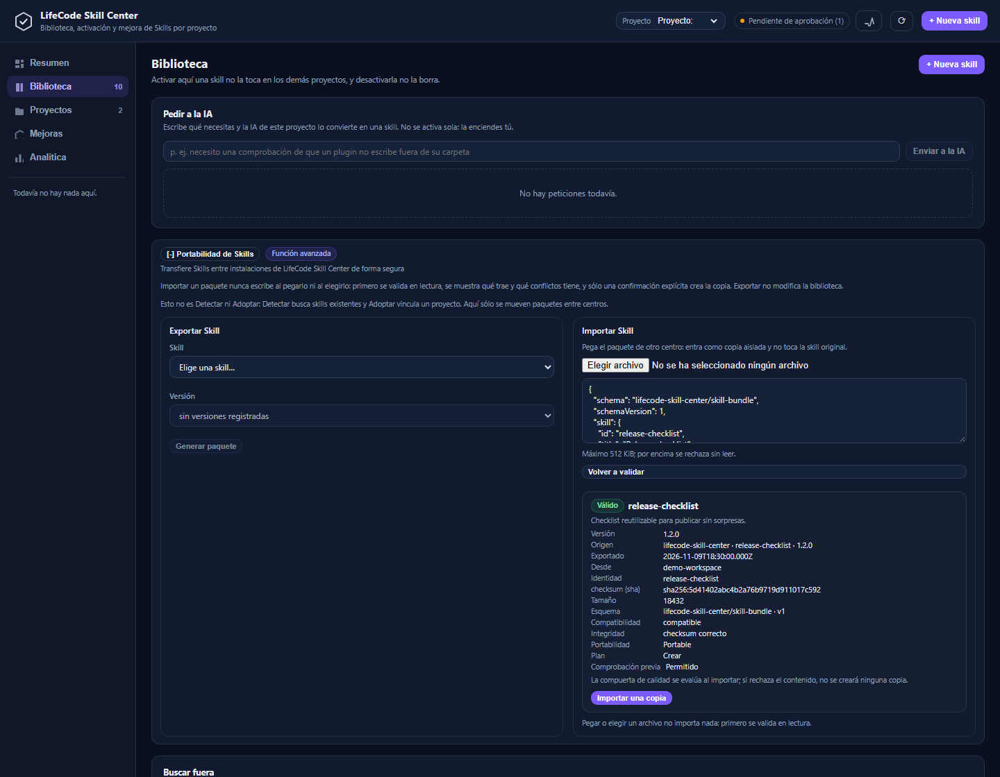

# LifeCode Skill Center

<p align="center">
  
</p>

<h3 align="center">Turn AI Experience Into Reusable Knowledge</h3>
<p align="center"><strong>Knowledge is Power. Skills Preserve Knowledge.</strong></p>

<p align="center">
  <strong>Version 1.0.1 — Stable</strong> · MIT · Contract v2<br>
  <a href="docs/INSTALLATION.md">Installation</a> ·
  <a href="docs/ARCHITECTURE.md">Architecture</a> ·
  <a href="docs/SECURITY.md">Security</a> ·
  <a href="docs/TROUBLESHOOTING.md">Troubleshooting</a> ·
  <a href="CHANGELOG.md">Changelog</a>
</p>

<p align="center">
  
</p>

## Your AI Knowledge. Organized, Protected and Reusable.

Great AI work produces more than answers: it produces **knowledge** — the reasoning, the checks, the
decisions, and the hard-won steps that made the work succeed. LifeCode Skill Center turns that knowledge
into **Skills** that can be reviewed, versioned, protected, and reused across projects.

It is not a prompt manager. It is a **knowledge preservation and management system** for the Skills behind
your best AI workflows. The AI creates and proposes; a person approves and enables.

<p align="center">
  
</p>

---

## The Problem — AI Knowledge Shouldn't Disappear

AI knowledge usually lives in places that do not preserve it: a long conversation, a memory that changes
between sessions, a file with an unclear origin, or a copy that no one can safely reuse. The result is not
only lost time; it is lost judgment.

| Problem | Consequence | LifeCode response |
|---|---|---|
| Knowledge is scattered across sessions and files | The next person cannot find what worked, or trusts the wrong copy | One persistent library with provenance for every row |
| Experience is not reusable | Teams repeat the same discovery work | Skills are portable, versioned knowledge units |
| There are no real versions | A change silently replaces what worked | Immutable versions, exact pins, explicit rollback |
| Assignment has no project context | A global Skill is switched on where it does not belong | Per-project assignment with an on/off switch |
| Identities and names collide | Two different Skills look like one, or one is silently shadowed | Six collision types plus a fail-closed preflight |
| Improvements arrive without review | Quality drifts and nobody notices | A deterministic quality gate before publication |
| Transfer between installations is painful | Knowledge cannot move without copying files by hand | JSON Skill bundles with a read-only preview |
| Activity cannot be traced | Nobody can explain what changed, when, or by whom | An Activity Center with actor, source, and evidence |

**AI experience should not end when the conversation does.**

## The Solution

LifeCode Skill Center turns AI experience into reusable knowledge through a governed lifecycle:

1. **Capture** the reusable procedure as a Skill.
2. **Preserve** it in a persistent, versioned library.
3. **Evaluate** it with a deterministic quality gate.
4. **Protect** it with immutable versions and human approval.
5. **Reuse** it through explicit per-project assignment.
6. **Improve** it through new versions that never overwrite live content silently.

Every step is visible. Every risky write is checked against evidence. Every activation is a human act.

## One Center. A Complete Skill Lifecycle

| | Pillar | What it gives you |
|---|---|---|
| **01** | **Create & Preserve** | Turn a procedure, a fix, or a hard-won check into a stable Skill with a durable identity and history. |
| **02** | **Organize & Activate** | Assign an exact version to one project, see what each project has, and switch it off without deleting knowledge. |
| **03** | **Evaluate & Improve** | Run a local, deterministic gate; propose an improvement as a new version; keep the live version until a person approves. |
| **04** | **Protect & Govern** | Fail-closed preflight, collision detection, project identity rules, and boundaries between AI actions and human decisions. |
| **05** | **Transfer & Reuse** | Move one Skill between installations as a single JSON bundle, validated in read-only mode before an explicit confirmation. |

**Create. Preserve. Improve. Reuse.**

## Everything You Need to Manage AI Skills

### Skill Management
A persistent library with stable ids, semantic versions, immutable releases, rollback, a deterministic
quality gate, and a global inventory that separates **owner**, **origin**, **location**, **scope**,
**association**, and **execution**. Confidence is declared per row: `verified` → `manifest` →
`plugin-contract` → `local-registry` → `content-hash` → `name-only` → `unknown`.

### Project Management
Seven project observations — `discovered`, `external-managed`, `managed`, `healthy`, `unavailable`,
`identity-conflict`, and `partially-inspected`. Registration creates an administrative link in the center's
own store and a manifest; it does not write inside the project. A deleted or moved folder becomes
`unavailable`; nothing is deleted automatically.

### Quality & Governance
Six collision types — `identity-duplicate`, `name-collision`, `path-collision`, `content-collision`,
`assignment-shadowed`, and `legacy-collision` — plus a preflight that **blocks** an operation when a
required source of evidence is missing. The agent can search, create, improve, and inspect; it cannot
approve, publish, assign, or enable.

### Knowledge Preservation
Immutable versions, exact pins, a separate journal for knowledge events, and a derived materialized view
that the Harness loads. The store is local user data; no database and no external service are required.

### Activity & Visibility
An Activity Center derived from the operations that actually happened, with category, severity, actor,
source, evidence, and confidence. Notifications appear inside the DeepSeek Harness web UI: success and info
after 6 s, warnings after 8 s, errors until dismissed. A global toast over a live conversation is
**verified by contract and transport tests; the 12-step live acceptance is still pending**.

## More Than a Skill Library

- **A lifecycle, not a folder.** Create, preserve, evaluate, version, assign, reuse, and improve are one
  governed flow, not disconnected features.
- **Project context, not global toggles.** Assignment carries the project it belongs to; a Skill is on in
  one place and off everywhere else.
- **Evidence, not guesses.** Every inventory row and every blocked write says what it knows, what it does
  not know, and which source was missing.
- **Boundaries, not automation theatre.** The model proposes; the person decides. No scheduler, no
  background learning, and no self-approval.
- **Provenance, not a name.** A repeated name is reported as ambiguity, not treated as a global identity.

## Product Showcase

Every screenshot below is a synthetic render of the real client bundle with neutral fixture data. They
contain no personal paths, private project names, or tokens.

### Projects: know what exists before you administer it
Discover Host workspaces, inspect them read-only, and register only what you choose.


### Skill detail: the whole story of one Skill
Versions, quality, provenance, confidence, assignments, and references in one place.



### Project detail: six sections, one coherent view
Summary, Skills, origin, conflicts, activity, and identity for a single project.



### Collisions: find the conflict before it becomes an incident
Identity, name, path, content, assignment, and legacy collisions — with severity and evidence.



### Activity Center: what was created, improved, or preserved
A cursor-paginated feed with actor, source, evidence, and honest confidence labels.



### Notifications: feedback where the work happens
In-app toasts confirm a persisted operation; errors stay until dismissed.



### Chat visibility: the same event over a conversation
The global overlay uses the Host's existing session events — no polling and no new channel.



### Portability: move knowledge, inspect first
A single JSON bundle, a read-only preview, and an explicit confirmation before a copy is created.



## How It Works

```text
   Conversation / task
          │
          ▼
     Capture ──────► Skill (SKILL.md + optional references)
          │                    │
          │                    ▼
          │             Evaluate (deterministic gate)
          │                    │
          │                    ▼
          │             Version (immutable)
          │                    │
          │                    ▼
          │             Assign to a project (exact version)
          │                    │
          │                    ▼
          └──────────► Reuse / Improve (new version, human approval)
```

The Harness provider serves an assigned Skill for a project. **Loaded** means the catalog offered it; it
is not proof that the model applied it. The Activity Center reports both the action and the evidence behind
that attribution.

## Why LifeCode

Most tools stop at “save this prompt”. LifeCode Skill Center preserves the **knowledge behind the workflow**:
the procedure, the checks, the decisions, and the conditions under which they are safe to reuse.

- **Built for preservation**, not just retrieval.
- **Built for projects**, not a single global pile of text.
- **Built for trust**, with human approval, provenance, and evidence at every boundary.
- **Built to stay local**, with user-owned storage and no telemetry.

*LifeCode Skill Center preserves the knowledge behind every great AI workflow.*

## Verification Snapshot

The 1.0.1 candidate was verified on a frozen tree. These are candid snapshot results, not a promise about
future builds:

| Gate | Result |
|---|---|
| Test suite | **935 / 935 passing** |
| Structural checks | **420 / 420** |
| End-to-end | **19 / 19** (real store unchanged) |
| Autonomous end-to-end | **26 / 26** |
| Mutation (critical / total) | **13 / 13 · 16 / 16** |
| Performance budget checks | **11 / 11** |

`tools/testquality.mjs` remains **red with a pre-existing finding** (1 high: `tests/state.test.mjs:144`,
a catch that does not verify). It is declared, not hidden. Full reproducible evidence:
[`_audit/FINAL-RELEASE-READINESS.md` §E](../_audit/FINAL-RELEASE-READINESS.md).

## Installation

> **Status: installation from GitHub is not verified yet (BLOCKED by publication).** The verified route in
> this repository is a local install from an absolute path.

```sh
git clone https://github.com/designerbyron/plugins-dsh.git
cd <donde-clonaste-el-repo>/lifecode-skill-center
npm install
```

1. Open **Plugins → Add plugin**.
2. Paste the absolute path of `lifecode-skill-center`, install, and choose **Enable now**.
3. Restart the Harness if the install result asks for it, then reload the web page.
4. Open **LifeCode Skill Center** in the sidebar and pick a project in the header.

A Git-address install is a **candidate** only: this is a monorepo and the installable bundle is the
`lifecode-skill-center/` subdirectory. See [INSTALLATION.md](docs/INSTALLATION.md) for the exact status, the
candidate syntax, and the temporary-profile test that is still pending.

## Documentation & Support

| Document | What it covers |
|---|---|
| [INSTALLATION.md](docs/INSTALLATION.md) | Install, enable, update, uninstall; verified and candidate routes. |
| [ARCHITECTURE.md](docs/ARCHITECTURE.md) | Host/client boundary, modules, store, API, activity, compatibility. |
| [SECURITY.md](docs/SECURITY.md) | Admission, approval boundary, preflight, bundle trust, limits. |
| [TROUBLESHOOTING.md](docs/TROUBLESHOOTING.md) | Installation, contract, store, and connection diagnostics. |
| [CHANGELOG.md](CHANGELOG.md) | What changed in 1.0.1 and earlier. |
| [docs/ARQUITECTURA.md](docs/ARQUITECTURA.md) · [DESARROLLO.md](docs/DESARROLLO.md) · [OPERACION.md](docs/OPERACION.md) | Detailed Spanish engineering record. |

Repository: [designerbyron/plugins-dsh](https://github.com/designerbyron/plugins-dsh) ·
Issues: [GitHub Issues](https://github.com/designerbyron/plugins-dsh/issues).

## Trust & Transparency

- **Human control.** Publishing, assigning, and enabling are human operations. The API rejects
  AI-originated approval calls with `approval-required`.
- **Fail-closed writes.** If a required source of evidence is missing, the operation is blocked, not
  guessed.
- **Provenance is part of the result.** A name is not a global identity; ambiguous groups are reported.
- **Portability is not authenticity.** A bundle checksum proves transport integrity, not authorship.
- **Local-first storage.** The store lives under `DSH_HOME`; the plugin declares no telemetry.
- **Honest limits.** No operating-system notification and no push with the Harness closed; `skill.loaded`
  is an offer/load signal, not proof of application; activity history is bounded and paginated; GitHub
  installation is unverified.

Storage: `<DSH_HOME>/lifecode-skill-center/` holds `center.json`, `knowledge.json`, `materialized/`,
`projects/<id>/manifest.json`, and `exports/`. `LIFECODE_SKILL_CENTER_ROOT` can relocate the store.

## License

**LifeCode Skill Center v1.0.1** · [Installation](docs/INSTALLATION.md) ·
[Changelog](CHANGELOG.md) · [Repository](https://github.com/designerbyron/plugins-dsh) · MIT

MIT — see [LICENSE](LICENSE). Copyright © 2026 Byron Vanegas.

### Original Creator & Developer

LifeCode Skill Center was originally created and developed by Byron Vanegas as part of the LifeCode
ecosystem.

- Official repository: <https://github.com/designerbyron/plugins-dsh>
- Recommended attribution for forks:
  `Based on LifeCode Skill Center, originally created and developed by Byron Vanegas.`

The attribution above is recommended, not an additional license condition: the MIT obligation is to keep
the copyright and permission notices. The license does not grant trademark rights; see
[docs/LEGAL.md](docs/LEGAL.md) for product name, logo, and derivative-work guidance.

LifeCode is the product family; LifeCode Skill Center is an independent plugin in that family.

---

# Español

<p align="center">
  
</p>

<h3 align="center">Convierte la experiencia de la IA en conocimiento reutilizable</h3>
<p align="center"><strong>El conocimiento es poder. Las Skills preservan el conocimiento.</strong></p>

<p align="center">
  <strong>Versión 1.0.1 — Estable</strong> · MIT · Contrato v2<br>
  <a href="docs/INSTALLATION.md">Instalación</a> ·
  <a href="docs/ARCHITECTURE.md">Arquitectura</a> ·
  <a href="docs/SECURITY.md">Seguridad</a> ·
  <a href="docs/TROUBLESHOOTING.md">Diagnóstico</a> ·
  <a href="CHANGELOG.md">Cambios</a>
</p>

## Tu conocimiento de IA. Organizado, protegido y reutilizable.

El trabajo valioso con IA produce más que respuestas: produce **conocimiento** — el razonamiento, las
comprobaciones, las decisiones y los pasos que hicieron que el trabajo saliera bien. LifeCode Skill Center
convierte ese conocimiento en **Skills** que se pueden revisar, versionar, proteger y reutilizar entre
proyectos.

No es un gestor de prompts. Es un sistema de **conservación y gestión estructurada del conocimiento** que
hay detrás de tus mejores flujos de trabajo con IA. La IA crea y propone; una persona aprueba y enciende.


---

## El problema — el conocimiento de la IA no debería desaparecer

El conocimiento de la IA suele quedar en sitios que no lo conservan: una conversación larga, una memoria que
cambia entre sesiones, un fichero de origen dudoso o una copia que nadie puede reutilizar con seguridad. Lo
que se pierde no es sólo tiempo: es criterio.

| Problema | Consecuencia | Respuesta de LifeCode |
|---|---|---|
| Conocimiento disperso entre sesiones y ficheros | La siguiente persona no encuentra lo que funcionó o confía en la copia equivocada | Una biblioteca persistente con procedencia en cada fila |
| Experiencia no reutilizable | El equipo repite el mismo trabajo de descubrimiento | Skills como unidades de conocimiento portables y versionadas |
| Sin versiones reales | Un cambio sustituye en silencio lo que funcionaba | Versiones inmutables, fijación exacta y vuelta atrás explícita |
| Asignación sin contexto de proyecto | Una Skill global se enciende donde no corresponde | Asignación por proyecto con interruptor |
| Identidades y nombres duplicados | Dos Skills distintas parecen una, o una queda sombreada | Seis tipos de colisión y un preflight fail-closed |
| Mejoras sin revisión | La calidad se degrada y nadie lo detecta | Compuerta de calidad determinista antes de publicar |
| Transferencia difícil | El conocimiento no se mueve sin copiar ficheros a mano | Paquetes JSON con vista previa de sólo lectura |
| Actividad no rastreable | Nadie puede explicar qué cambió, cuándo ni quién | Centro de Actividad con actor, origen y evidencia |

**La experiencia de la IA no debería terminar cuando termina la conversación.**

## La solución

LifeCode Skill Center convierte la experiencia de la IA en conocimiento reutilizable mediante un ciclo
gobernado:

1. **Capturar** el procedimiento reutilizable como Skill.
2. **Preservarlo** en una biblioteca persistente y versionada.
3. **Evaluarlo** con una compuerta de calidad determinista.
4. **Protegerlo** con versiones inmutables y aprobación humana.
5. **Reutilizarlo** mediante asignación explícita por proyecto.
6. **Mejorarlo** con versiones nuevas que nunca pisan en silencio el contenido vivo.

Cada paso es visible. Cada escritura arriesgada se contrasta con evidencia. Cada activación es un acto humano.

## Un centro. Un ciclo de vida completo de la Skill

| | Pilar | Qué te da |
|---|---|---|
| **01** | **Crear y preservar** | Convierte un procedimiento, un arreglo o una comprobación en una Skill estable, con identidad e historial. |
| **02** | **Organizar y activar** | Asigna una versión exacta a un proyecto, consulta lo que tiene cada uno y apaga sin borrar conocimiento. |
| **03** | **Evaluar y mejorar** | Ejecuta una compuerta local y determinista; propone mejoras como versión nueva; la versión viva espera aprobación. |
| **04** | **Proteger y gobernar** | Preflight fail-closed, detección de colisiones, reglas de identidad de proyecto y frontera entre IA y persona. |
| **05** | **Transferir y reutilizar** | Mueve una Skill entre instalaciones como un único JSON, validado en lectura antes de una confirmación explícita. |

**Crear. Preservar. Mejorar. Reutilizar.**

## Todo lo que necesitas para gestionar Skills de IA

### Gestión de Skills
Biblioteca persistente con ids estables, versiones semánticas, publicaciones inmutables, vuelta atrás,
compuerta de calidad determinista e inventario global que separa **dueño**, **origen**, **ubicación**,
**ámbito**, **asociación** y **ejecución**. La confianza se declara por fila: `verified` → `manifest` →
`plugin-contract` → `local-registry` → `content-hash` → `name-only` → `unknown`.

### Gestión de proyectos
Siete observaciones: `discovered`, `external-managed`, `managed`, `healthy`, `unavailable`,
`identity-conflict` y `partially-inspected`. El registro crea un vínculo administrativo en el almacén del
centro y un manifiesto; no escribe dentro del proyecto. Una carpeta movida o borrada pasa a `unavailable`;
nada se borra automáticamente.

### Calidad y gobierno
Seis colisiones — `identity-duplicate`, `name-collision`, `path-collision`, `content-collision`,
`assignment-shadowed` y `legacy-collision` — más un preflight que **bloquea** cuando falta una fuente de
evidencia requerida. El agente puede buscar, crear, mejorar e inspeccionar; no puede aprobar, publicar,
asignar ni encender.

### Conservación del conocimiento
Versiones inmutables, fijaciones exactas, un diario separado para eventos de conocimiento y una vista
materializada derivada que el Harness carga. El almacén es dato local del usuario; no requiere base de datos
ni servicio externo.

### Actividad y visibilidad
Centro de Actividad derivado de las operaciones que ocurrieron de verdad, con categoría, severidad, actor,
origen, evidencia y confianza. Las notificaciones aparecen dentro de la interfaz web de DeepSeek Harness:
éxito e info a los 6 s, avisos a los 8 s, errores hasta que se descartan. El aviso global sobre una
conversación está **verificado por pruebas de contrato y transporte; la aceptación viva de 12 pasos sigue
pendiente**.

## Más que una biblioteca de Skills

- **Un ciclo de vida, no una carpeta.** Crear, preservar, evaluar, versionar, asignar, reutilizar y mejorar
  forman un flujo gobernado.
- **Contexto de proyecto, no interruptores globales.** La asignación lleva el proyecto al que pertenece; una
  Skill está encendida en un sitio y apagada en los demás.
- **Evidencia, no suposiciones.** Cada fila del inventario y cada bloqueo dicen qué saben, qué no saben y
  qué fuente faltó.
- **Fronteras, no teatro de automatización.** El modelo propone; la persona decide. Sin planificador, sin
  aprendizaje de fondo y sin autoaprobación.
- **Procedencia, no un nombre.** Un nombre repetido se declara como ambigüedad, no como identidad global.

## Producto en capturas

Todas las imágenes son renders sintéticos del cliente real con datos de fixture neutros. No contienen rutas
personales, nombres de proyectos privados ni tokens.

### Proyectos: saber qué existe antes de administrarlo
Descubre workspaces del Host, inspecciónalos en lectura y registra sólo lo que elijas.


### Ficha de Skill: la historia completa de una Skill
Versiones, calidad, procedencia, confianza, asignaciones y referencias en un solo lugar.


### Ficha de proyecto: seis secciones, una vista coherente
Resumen, Skills, origen, conflictos, actividad e identidad de un proyecto.


### Colisiones: encontrar el conflicto antes de que sea un incidente
Colisiones de identidad, nombre, ruta, contenido, asignación y legado, con severidad y evidencia.


### Centro de Actividad: qué se creó, mejoró o conservó
Un flujo paginado por cursor con actor, origen, evidencia y confianza honesta.


### Notificaciones: respuesta donde ocurre el trabajo
Avisos dentro de la interfaz que confirman una operación persistida; los errores esperan a que se descarten.


### Visibilidad en el chat: el mismo evento sobre una conversación
La capa global usa los eventos de sesión que el Host ya entrega: sin polling y sin canal nuevo.


### Portabilidad: mover conocimiento, inspeccionar primero
Un único paquete JSON, una vista previa de sólo lectura y una confirmación explícita antes de crear la copia.


## Cómo funciona

```text
   Conversación / tarea
          │
          ▼
     Capturar ──────► Skill (SKILL.md + referencias opcionales)
          │                    │
          │                    ▼
          │             Evaluar (compuerta determinista)
          │                    │
          │                    ▼
          │             Versionar (inmutable)
          │                    │
          │                    ▼
          │             Asignar a un proyecto (versión exacta)
          │                    │
          │                    ▼
          └──────────► Reutilizar / Mejorar (versión nueva, aprobación humana)
```

El proveedor del Harness sirve una Skill asignada a un proyecto. **Cargada** significa que el catálogo la
ofreció; no prueba que el modelo la aplicara. El Centro de Actividad informa tanto de la acción como de la
evidencia que sostiene esa atribución.

## Por qué LifeCode

La mayoría de las herramientas se quedan en «guardar este prompt». LifeCode Skill Center preserva el
**conocimiento que hay detrás del flujo de trabajo**: el procedimiento, las comprobaciones, las decisiones y
las condiciones en las que es seguro reutilizarlo.

- **Diseñado para preservar**, no sólo para recuperar.
- **Diseñado para proyectos**, no para un montón global de texto.
- **Diseñado para confiar**, con aprobación humana, procedencia y evidencia en cada frontera.
- **Diseñado para quedarse en local**, con almacenamiento del usuario y sin telemetría.

*LifeCode Skill Center preserva el conocimiento que hay detrás de cada gran flujo de trabajo con IA.*

## Verificación del snapshot

El candidato 1.0.1 se verificó sobre un árbol congelado. Son resultados honestos del snapshot, no una
promesa sobre versiones futuras:

| Gate | Resultado |
|---|---|
| Suite de pruebas | **935 / 935 correctas** |
| Comprobaciones estructurales | **420 / 420** |
| End-to-end | **19 / 19** (almacén real sin cambios) |
| End-to-end autónomo | **26 / 26** |
| Mutación (críticos / total) | **13 / 13 · 16 / 16** |
| Comprobaciones de rendimiento | **11 / 11** |

`tools/testquality.mjs` sigue **rojo con un hallazgo preexistente** (1 alto: `tests/state.test.mjs:144`, un
catch que no verifica). Se declara, no se oculta. Evidencia reproducible completa:
[`_audit/FINAL-RELEASE-READINESS.md` §E](../_audit/FINAL-RELEASE-READINESS.md).

## Instalación

> **Estado: la instalación desde GitHub no está verificada todavía (BLOCKED por publicación).** La ruta
> verificada en este repositorio es la instalación local desde una ruta absoluta.

```sh
git clone https://github.com/designerbyron/plugins-dsh.git
cd <donde-clonaste-el-repo>/lifecode-skill-center
npm install
```

1. Abrir **Plugins → Add plugin**.
2. Pegar la ruta absoluta de `lifecode-skill-center`, instalar y elegir **Enable now**.
3. Reiniciar el Harness si el resultado lo pide y recargar la página web.
4. Abrir **LifeCode Skill Center** en la barra lateral y elegir un proyecto en la cabecera.

La instalación por dirección Git es sólo un **candidato**: es un monorepo y el bundle instalable es el
subdirectorio `lifecode-skill-center/`. Ver [INSTALLATION.md](docs/INSTALLATION.md) para el estado exacto,
la sintaxis candidata y la prueba con perfil temporal que sigue pendiente.

## Documentación y soporte

| Documento | Qué cubre |
|---|---|
| [INSTALLATION.md](docs/INSTALLATION.md) | Instalar, habilitar, actualizar y desinstalar; rutas verificada y candidata. |
| [ARCHITECTURE.md](docs/ARCHITECTURE.md) | Frontera Host/cliente, módulos, almacén, API, actividad y compatibilidad. |
| [SECURITY.md](docs/SECURITY.md) | Admisión, frontera de aprobación, preflight, confianza de paquetes y límites. |
| [TROUBLESHOOTING.md](docs/TROUBLESHOOTING.md) | Diagnóstico de instalación, contrato, almacén y conexión. |
| [CHANGELOG.md](CHANGELOG.md) | Qué cambió en 1.0.1 y anteriores. |
| [docs/ARQUITECTURA.md](docs/ARQUITECTURA.md) · [DESARROLLO.md](docs/DESARROLLO.md) · [OPERACION.md](docs/OPERACION.md) | Registro técnico detallado en español. |

Repositorio: [designerbyron/plugins-dsh](https://github.com/designerbyron/plugins-dsh) ·
Incidencias: [GitHub Issues](https://github.com/designerbyron/plugins-dsh/issues).

## Confianza y transparencia

- **Control humano.** Publicar, asignar y encender son operaciones humanas. La API rechaza las llamadas de
  aprobación de la IA con `approval-required`.
- **Escrituras fail-closed.** Si falta una fuente de evidencia requerida, la operación se bloquea; no se
  adivina.
- **La procedencia es parte del resultado.** Un nombre no es una identidad global; los grupos ambiguos se
  declaran.
- **Portabilidad no es autenticidad.** El checksum de un paquete prueba integridad de transporte, no autoría.
- **Almacenamiento local.** El almacén vive bajo `DSH_HOME`; el plugin no declara telemetría.
- **Límites honestos.** Sin notificación del sistema operativo ni push con el Harness cerrado;
  `skill.loaded` es señal de oferta/carga, no prueba de aplicación; el historial está acotado y paginado; la
  instalación desde GitHub no está verificada.

Almacén: `<DSH_HOME>/lifecode-skill-center/` contiene `center.json`, `knowledge.json`, `materialized/`,
`projects/<id>/manifest.json` y `exports/`. `LIFECODE_SKILL_CENTER_ROOT` puede reubicar el almacén.

## Licencia

**LifeCode Skill Center v1.0.1** · [Instalación](docs/INSTALLATION.md) ·
[Cambios](CHANGELOG.md) · [Repositorio](https://github.com/designerbyron/plugins-dsh) · MIT

MIT — ver [LICENSE](LICENSE). Copyright © 2026 Byron Vanegas.

### Creador y desarrollador original

LifeCode Skill Center fue creado y desarrollado originalmente por Byron Vanegas como parte del ecosistema
LifeCode.

- Repositorio oficial: <https://github.com/designerbyron/plugins-dsh>
- Atribución recomendada para forks:
  `Basado en LifeCode Skill Center, creado y desarrollado originalmente por Byron Vanegas.`

La atribución anterior es una recomendación, no una condición adicional de la licencia: la obligación de
MIT es conservar los avisos de copyright y de permiso. La licencia no concede derechos de marca; consulta
[docs/LEGAL.md](docs/LEGAL.md) para el nombre del producto, el logo y las obras derivadas.

LifeCode es la familia de producto; LifeCode Skill Center es un plugin independiente dentro de esa familia.
